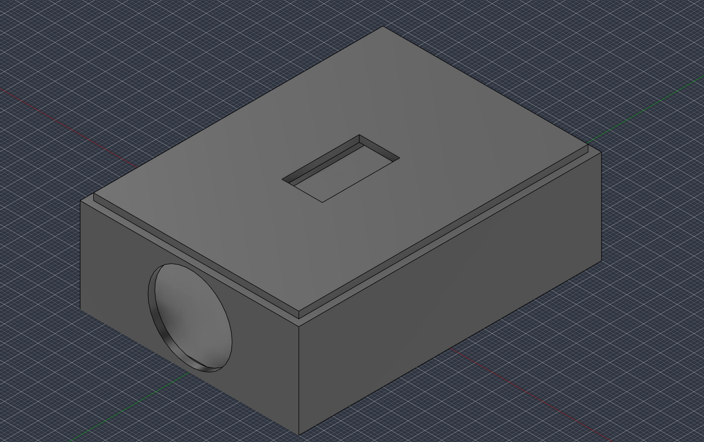
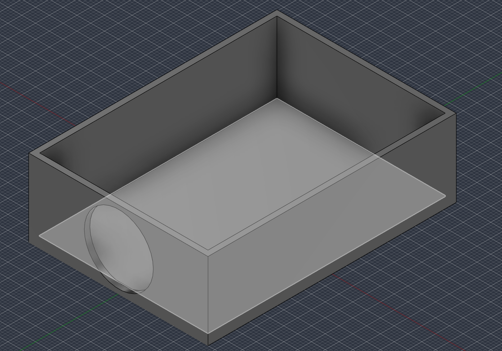
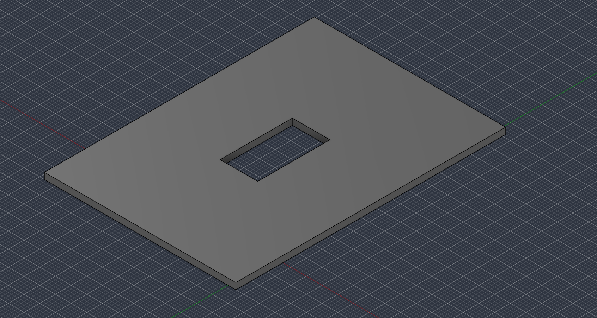

# 💧 Agua Clara

**Prototipo IoT para detectar cambios de turbiedad en agua de pozos y norias.**
Proyecto de TEI201 – Taller de Diseño en Ingeniería, Universidad Adolfo Ibáñez (Sección 7, Grupo 8).

> ⚠️ Agua Clara detecta **cambios relativos de turbiedad**; **no certifica potabilidad**. El prototipo no detecta microorganismos, sustancias químicas ni todos los parámetros asociados con la calidad del agua.

---

## Índice

1. [Equipo](#1-equipo)
2. [ODS y problema abordado](#2-ods-y-problema-abordado)
3. [Descripción del proyecto](#3-descripción-del-proyecto)
4. [Arquitectura del sistema](#4-arquitectura-del-sistema)
5. [Estado actual](#5-estado-actual)
6. [Entrega 1 – Avance #2: Prototipo Alpha IoT](#6-entrega-1--avance-2-prototipo-alpha-iot)
7. [Entrega 2 – Avance #3: Prototipo IoT y rediseño final](#7-entrega-2--avance-3-prototipo-iot-y-rediseño-final)
8. [Comparación Avance #2 vs. Entrega Final](#8-comparación-avance-2-vs-entrega-final)
9. [Hardware y conexiones](#9-hardware-y-conexiones)
10. [Estructura del repositorio](#10-estructura-del-repositorio)
11. [Advertencias de seguridad](#11-advertencias-de-seguridad)
12. [Fuentes y licencia](#12-fuentes-y-licencia)

---

## 1. Equipo

| Integrante | Rol |
|---|---|
| Raimundo Liedloff Díaz | Montaje electrónico y pruebas del sensor |
| Benjamín Sotomayor | Investigación, testing y validación del problema |
| Andrés Ubilla Moreno | Diseño del encapsulado y documentación técnica |
| José Tomás Tabja | Programación, conectividad e integración IoT |

## 2. ODS y problema abordado

**ODS 6: Agua limpia y saneamiento.**

Las familias de sectores rurales de Colina que utilizan pozos o norias pueden carecer de una herramienta doméstica sencilla para detectar y visualizar cambios en la turbiedad del agua que obtienen o almacenan.

Esta necesidad corresponde a una hipótesis del proyecto que debe validarse mediante entrevistas y pruebas con usuarios.

## 3. Descripción del proyecto

Agua Clara es un dispositivo portátil de alerta preliminar que utiliza un sensor de turbiedad conectado a una placa ESP32 para detectar cambios relativos en la apariencia óptica de una muestra de agua.

El sistema procesa la lectura del sensor, muestra el resultado en una pantalla OLED y lo transmite mediante Wi-Fi a una página web que se puede ver desde un celular o computador.

## 4. Arquitectura del sistema

```
Muestra de agua → Sensor de turbiedad → ESP32 → Procesamiento → Pantalla OLED + Wi-Fi → Página web en tiempo real (celular / computador)
```

## 5. Estado actual

| | |
|---|---|
| **Versión** | v3.0 – Entrega final |
| **Estado** | Prototipo IoT: captura continua, visualización local (OLED) y remota (web por Wi-Fi) en tiempo real, con estados de alerta |
| **Entregas incluidas** | Entrega 1 (Avance #2) y Entrega 2 (Avance #3) |

Agua Clara evolucionó desde una prueba de concepto en protoboard (Avance #2), con lecturas inestables, hacia un prototipo IoT con un nuevo sensor, una carcasa rediseñada y una página web con el estado del agua en tiempo real (Avance #3).

---

## 6. Entrega 1 – Avance #2: Prototipo Alpha IoT

*Versión v2.0-alpha · Última actualización: 25 de octubre de 2026.*

### 6.1 Situación del prototipo

En esta etapa el funcionamiento era inestable y las lecturas del sensor entregaban resultados irregulares: valores muy distintos para la misma muestra de agua limpia o turbia (oscilaciones entre ~70 y ~210 RAW sin cambios en la muestra).

Para intentar corregir estos errores:

- Modificamos las conexiones físicas y cambiamos los cables en múltiples ocasiones para reducir la inestabilidad.
- Ajustamos y reescribimos el código varias veces para probar distintas formas de leer el sensor.
- Realizamos pruebas continuas rearmando el circuito base.

Estos problemas quedaron documentados como parte del proceso de aprendizaje y fueron la base empírica de las mejoras de la entrega final.

### 6.2 Iteraciones realizadas

| Iteración | Tema | Resultado / aprendizaje |
|---|---|---|
| [Iteración 1](iteraciones/iteracion_1/) | Cambio de alcance | La propuesta inicial medía pH, conductividad y turbiedad. Se redujo solo a **turbiedad** para lograr un prototipo funcional y demostrable en el tiempo disponible. |
| [Iteración 2](iteraciones/iteracion_2/) | Primeras lecturas del sensor | Las lecturas no fueron repetibles entre sesiones (ver tabla abajo). Se decidió **no definir umbrales** todavía. |
| [Iteración 3](iteraciones/iteracion_3/) | Revisión de conexiones | No se podía confirmar que el divisor de voltaje estuviera bien armado ni que llegara a GPIO34. Se definió un protocolo de medición con multímetro antes de reconectar. |

### 6.3 Pruebas iniciales del sensor

| Sesión | Muestra | Lectura |
|---|---|---|
| 1 | Agua limpia | Menos de 70 RAW |
| 1 | Agua turbia | 109,69 RAW promedio |
| 2 | Agua limpia | ≈ 210 RAW |
| 2 | Agua turbia | ≈ 195 RAW |

En la sesión 1 el agua turbia dio una lectura mayor; en la sesión 2, el agua limpia. Posibles causas: conexiones inestables, divisor de voltaje no verificado, distinta posición o profundidad de la sonda, distinto tiempo de estabilización, variaciones en las muestras y en la alimentación.

Datos y reporte completo: [`testing/`](testing/).

### 6.4 Avances completados en la Entrega 1

- ✅ Definición del problema y alcance
- ✅ Selección del sensor de turbiedad
- ✅ Recolección inicial de componentes
- ✅ Código inicial para lectura analógica
- ✅ Modelo 3D conceptual inicial (carcasa v1)
- ✅ Inspección visual del montaje

### 6.5 Pendientes que quedaron para la Entrega 2

- Confirmar eléctricamente las conexiones del sensor y verificar la salida analógica con multímetro
- Confirmar el divisor de voltaje y obtener lecturas estables por GPIO34
- Integrar la pantalla OLED y el relé como actuador
- Implementar la conectividad Wi-Fi
- Ejecutar una prueba continua de cinco minutos y documentar los resultados

---

## 7. Entrega 2 – Avance #3: Prototipo IoT y rediseño final

Para la entrega final se consolidó el ciclo de datos (captura → procesamiento → visualización → alerta) y se hicieron tres cambios mayores respecto al Avance #2.

### 7.1 Arquitectura base

- **ESP32** gestiona la adquisición de datos analógicos, la visualización local en la **pantalla OLED I2C** y la clasificación del agua en tres estados (baja turbiedad, verificar, turbiedad elevada).
- **Integración IoT:** el sistema ya no depende solo de lecturas locales; el ESP32 crea su propia red Wi-Fi ("AguaClara") y levanta una **página web** que se actualiza cada 3 segundos y cambia de color según el estado del agua.

### 7.2 Cambio A – Nuevo sensor de turbiedad (hardware)

- **Diagnóstico previo:** el sensor del Avance #2 presentaba saltos erráticos en la señal (70–210 RAW sin cambios en la muestra).
- **Modificación:** se adquirió e integró un nuevo sensor de turbiedad **DFRobot SEN0189** (Gravity Analog Turbidity Sensor). Fotos en [`hardware/`](hardware/).
- **Impacto técnico:**
  - Se ajustó el divisor resistivo para proteger la entrada analógica GPIO34 del ESP32 (máx. 3,3 V).
  - Se actualizó la lista de materiales (BOM) con los costos reales del nuevo sensor, resistencias y cableado (costo total ≈ $25.000 CLP, ver [`hardware/bom/`](hardware/bom/)).
  - Se calibraron en el firmware los umbrales que convierten la lectura RAW en tres estados (2273 y 2238 RAW, ver sección 7.4).

### 7.3 Cambio B – Rediseño del encapsulado 3D y diseño para la reparación

- **Diagnóstico previo:** la carcasa v1 estaba ajustada al sensor antiguo y no tenía holguras para ordenar cables ni acceso rápido para mantenimiento.
- **Modificación:** se rediseñó la caja en Fusion 360 ([`diseno_3d/`](diseno_3d/)), adaptada al nuevo sensor, con espacio interior (165 × 65 × 40 mm) para la placa ESP32, la protoboard, el módulo del sensor y el cableado.
- **Impacto técnico:**
  - **Diseño para la reparación:** sin pegamentos; caja inferior y tapa superior son piezas independientes y la tapa es desmontable (encaja con un reborde y 0,4 mm de holgura por lado). Las conexiones con cables Dupont permiten abrir el case y cambiar componentes sin dañar la estructura.
  - **Protección:** la electrónica (ESP32, protoboard y módulo del sensor) queda dentro de la caja y solo la sonda sale por una abertura circular hacia la muestra. La tapa tiene una ventana de 25 × 17 mm para la OLED. El case no es impermeable, así que la electrónica debe mantenerse seca.
  - **Dimensiones:** 170 × 70 × 43 mm exteriores, paredes de 2,5 mm, fondo y tapa de 3 mm; pensado para impresión 3D FDM en PLA.
  - **Planos técnicos:** cotas y tolerancias de impresión ([`diseno_3d/planos/`](diseno_3d/planos/)).

| Vista exterior | Vista interior | Tapa con OLED |
|---|---|---|
|  |  |  |

### 7.4 Cambio C – Ciclo de datos y validación (software y testing)

- **Modificación:** se actualizó el firmware del ESP32 ([`software/src/`](software/src/)) con un promedio de 20 lecturas por medición, umbrales calibrados con el nuevo sensor y la visualización en la página web.
- **Impacto técnico:**
  - **Visualización en tiempo real:** la lectura y el estado del agua se muestran en la OLED y en la página web, con colores según los umbrales de advertencia.
  - **Validación:** prueba comparativa con una muestra de agua limpia y una de agua turbia, que muestra la reducción de ruido frente al Avance #2 (resultados abajo).

#### Resultados con el sensor DFRobot SEN0189 (20-11-2026)

**Objetivo:** validar la estabilidad de lectura y la capacidad del nuevo sensor para diferenciar agua limpia de agua turbia.

**Condiciones:** ESP32 Dev Module, ADC de 12 bits (0–4095) por GPIO34. Cada lectura es el promedio de 20 muestras tomadas cada 10 ms (`analogRead` y `analogReadMilliVolts`), reportada en el monitor serial cada ~1 s (`delay(800)`).

**Criterio de éxito:** variación pequeña en estado estacionario (del orden de centésimas de volt) y separación clara, sin superposición, entre agua limpia y agua turbia.

| Prueba | Muestra | Lecturas registradas | Promedio RAW | Rango RAW | Voltaje promedio | Rango de voltaje |
|---|---|---|---|---|---|---|
| 1 | Agua limpia | 8 | 2286 | 2284 – 2288 | 2,041 V | 2,040 – 2,043 V |
| 2 | Agua turbia | 8 | 2221 | 2211 – 2241 | 1,986 V | 1,979 – 2,007 V |

- **Estabilidad:** con el sensor del Avance #2 la misma muestra variaba entre ~70 y ~210 RAW. Con el SEN0189 el agua limpia varió solo 4 RAW (0,003 V) y el agua turbia unos 30 RAW.
- **Comportamiento físico coherente:** en un sensor óptico, el agua más clara deja pasar más luz al fototransistor y entrega más voltaje (~2,041 V); al enturbiarse, los sólidos bloquean la luz y el voltaje baja (~1,986 V).
- **Diferenciación:** las dos muestras no se superponen; hay ≈65 RAW (≈0,055 V) de diferencia entre sus promedios.

**Umbrales calibrados** (a partir de estas dos muestras y ya cargados en `software/src/agua_clara.ino`; deben confirmarse con más pruebas):

| Voltaje | Lectura RAW (en el firmware) | Estado |
|---|---|---|
| ≥ 2,030 V | ≥ 2273 | Baja turbiedad |
| 2,000 – 2,029 V | 2238 – 2272 | Verificar |
| < 2,000 V | < 2238 | Turbiedad elevada → alerta |

- **Limitación:** es una sola sesión con una muestra de cada tipo. Quedan pendientes ensayos con niveles intermedios y altos de turbiedad, y repeticiones en distintos días.

Datos: [`testing/datos/pruebas_sen0189_2026-11-20.csv`](testing/datos/pruebas_sen0189_2026-11-20.csv) · Capturas: [`testing/evidencias/`](testing/evidencias/)

---

## 8. Comparación Avance #2 vs. Entrega Final

| Aspecto | Entrega 1 (Avance #2) | Entrega 2 (Avance #3 – Final) |
|---|---|---|
| **Sensor de turbiedad** | Sensor inicial con ruido elevado y deriva en las lecturas | DFRobot SEN0189: lecturas estables y umbrales calibrados con pruebas reales |
| **Encapsulado 3D** | Carcasa v1 ajustada al montaje preliminar | Caja rediseñada (170 × 70 × 43 mm) con tapa desmontable y ventana para la OLED |
| **Visualización y datos** | Lectura local en OLED y monitor serial | OLED + página web por Wi-Fi en tiempo real, con estados de alerta |
| **Documentación y BOM** | Estructura base y componentes sin costos | BOM con costos (≈ $25.000 CLP), planos acotados, nuevas fotos y [`FUENTES.md`](FUENTES.md) |

---

## 9. Hardware y conexiones

### Componentes principales

- Placa ESP32 (ESP32-S) con módulo de 2 relés integrado (conectado, pero desactivado en el firmware actual: `USAR_RELES = false`)
- Sensor de turbiedad DFRobot SEN0189 con su módulo electrónico (salida analógica y digital)
- Pantalla OLED I2C
- Protoboard, resistencias (divisor de voltaje para proteger la entrada analógica) y cables Dupont
- Cable Micro-USB
- Multímetro (para verificación)

### Pines del ESP32

| Componente | Pin |
|---|---|
| Sensor de turbiedad (salida A) | GPIO34 (entrada analógica, vía divisor de voltaje) |
| Pantalla OLED – SDA | GPIO19 |
| Pantalla OLED – SCL | GPIO18 |
| Relé 1 | GPIO13 |
| Relé 2 | GPIO15 |
| GND | Tierras unificadas, con la potencia del relé aislada para evitar reinicios de la placa |

Detalle completo en [`hardware/componentes_y_conexiones.md`](hardware/componentes_y_conexiones.md).

---

## 10. Estructura del repositorio

| Carpeta | Contenido |
|---|---|
| [`software/`](software/) | Código del ESP32 (`src/`) y simulación en Wokwi (`simulacion_wokwi/`) |
| [`hardware/`](hardware/) | Componentes, conexiones, fotos del montaje y BOM |
| [`testing/`](testing/) | Reporte de testing, datos en CSV y evidencias fotográficas |
| [`iteraciones/`](iteraciones/) | Problemas, cambios y aprendizajes de cada iteración |
| [`diseno_3d/`](diseno_3d/) | Archivos de Fusion 360, renders y planos del encapsulado |
| [`documentacion/`](documentacion/) | Informe del proyecto (`.docx`) y presentación (`.pptx`) |
| [`FUENTES.md`](FUENTES.md) | Declaración de fuentes |

---

## 11. Advertencias de seguridad

- ⚠️ No conectar una señal superior al rango permitido por el ESP32 (3,3 V).
- ⚠️ No conectar cargas de 220 V a los relés.
- ⚠️ No sumergir el módulo electrónico ni la placa ESP32.
- ⚠️ Solo la sección diseñada de la sonda debe entrar en contacto con el agua.
- ⚠️ No declarar resultados en NTU sin una calibración válida.

---

## 12. Fuentes y licencia

- Fuentes y referencias: [`FUENTES.md`](FUENTES.md)
- Licencia: ver [`LICENSE`](LICENSE)
