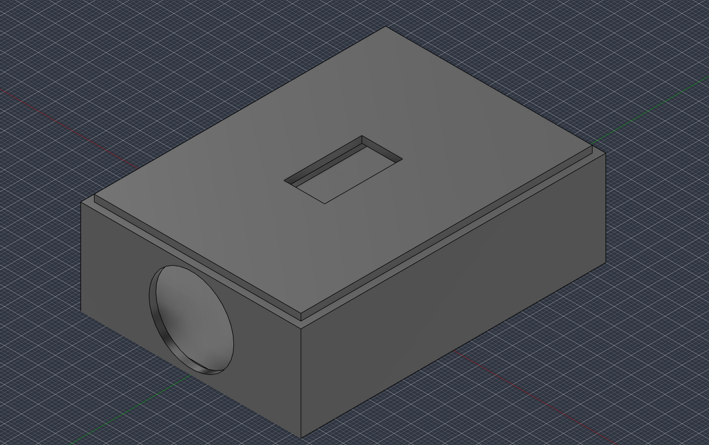
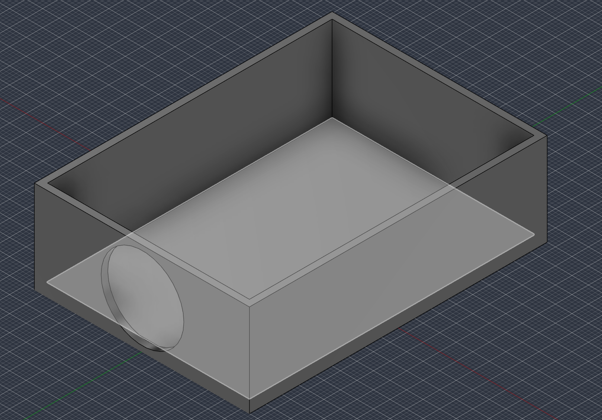
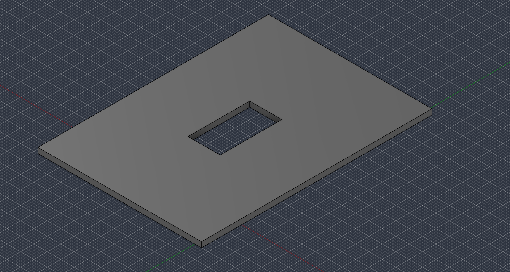

# Diseño 3D – Encapsulado Agua Clara

Encapsulado diseñado en **Autodesk Fusion** para proteger la electrónica y dejar solo la sonda del sensor en contacto con el agua.

| Carpeta | Contenido |
|---|---|
| [`fusion360/`](fusion360/) | Archivos editables `.f3d` (versión inicial y case final) |
| [`renders/`](renders/) | Vistas exterior, interior y de la tapa con la OLED |
| [`planos/`](planos/) | Plano técnico en PDF y medidas del case |

## Especificaciones (case final)

| | |
|---|---|
| Dimensiones exteriores | 170 × 70 × 43 mm |
| Espacio interior útil | 165 × 65 × 40 mm |
| Paredes / fondo / tapa | 2,5 mm / 3 mm / 3 mm |
| Piezas | Caja inferior + tapa superior desmontable |
| Ventana OLED | 25 × 17 mm en la tapa |
| Fabricación | Impresión 3D FDM, PLA, tolerancia ±0,3 mm, holgura de encaje 0,4 mm por lado |
| Unidades | Milímetros, escala 1:1 |

## Evolución

| Versión | Archivo | Cambio |
|---|---|---|
| v01 (Avance #2) | `Encapsulado_Agua_Clara_v01.f3d` | Modelo conceptual ajustado al montaje preliminar |
| Final (Avance #3) | `Agua clara Case final.f3d` | Rediseño para el sensor SEN0189: más espacio interior para cables, tapa desmontable, ventana para la OLED y salida para la sonda |

## Renders

| Exterior | Interior | Tapa con OLED |
|---|---|---|
|  |  |  |

## Pendientes de diseño
Según [`planos/medidas.md`](planos/medidas.md): soportes internos para la placa, fijación de la OLED, cierre de la tapa y verificación con los componentes físicos.

⚠️ El case **no es impermeable**: la electrónica debe mantenerse seca.
